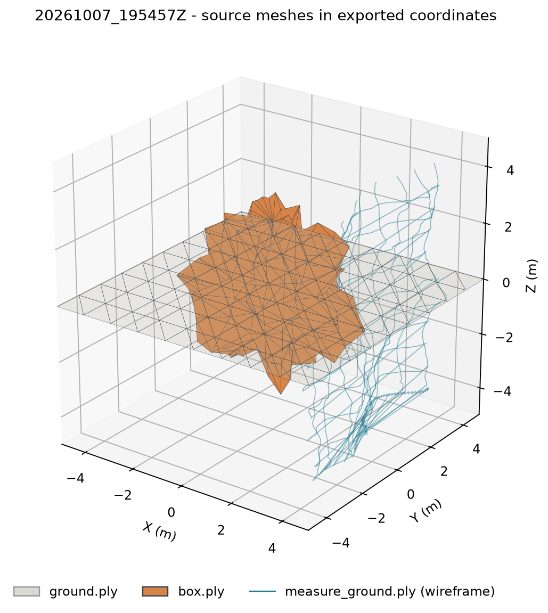

# HOUSIONNA scene rendering validation

## Source run

Validated the completed run `20261007_195457Z` from the sibling HOUSIONNA checkout. The source scene is `test1_scene.xml`; the run has 102 transmitters, one receiver, 578 paths, and 102 links at 3.5 GHz. Its saved radio map has one 19,602-triangle measurement surface with one value column per transmitter (1,999,404 samples total). The selected viewer scenario is `tx_0`.

## Meshes and source geometry

The scene XML references two RF scene shapes. Their PLY positions and indexed triangle faces match the normalized scene arrays exactly.

| Mesh | Source object / XML shape | RF material | Vertices | Triangles | Bounds (m) | Dimensions (m) | Centroid (m) |
|---|---|---|---:|---:|---|---|---|
| `ground.ply` | `ground` / `mesh-ground` | `medium_dry_ground_t1_s0` | 100 | 162 | X/Y: -5 to 5; Z: 0 | 10 x 10 x 0 | [0, 0, 0] |
| `box.ply` | `box` / `mesh-box` | `concrete_t0p2_s0` | 266 | 528 | X: -2.772466 to 3.173657; Y: -3.333372 to 2.987459; Z: -2.895198 to 3.191881 | 5.946123 x 6.320831 x 6.087079 | [0.008763, -0.008977, 0.057600] |

`ground.ply` is an open 10 x 10 m plane with 36 boundary edges, as expected for a single plane. `box.ply` is an irregular, faceted, closed mesh, not a rectangular box or a plant canopy. It has one connected component, no degenerate or duplicate triangles, no boundary or non-manifold edges, and positive signed volume of about 49.64 m3. Its winding is consistently outward under the closed-mesh signed-volume convention. It extends above and below the ground plane, so the box and ground surfaces intersect in the exported scene.

The measurement surface is a separate asset, not a third RF scene shape. `measure_ground.ply` has 10,000 vertices and 19,602 triangles. Its exported bounds are approximately X = 2.525306 to 4.799574 m, Y = -4.095 to 4.095 m, and Z = -4.095 to 4.095 m. In the verified Z-up frame this is a vertical panel, despite the `measure_ground` name.

## Coordinates and devices

The Houdini exporter applies `(x, y, z) -> (x, -z, y)` before writing Sionna geometry and devices. The exported PLY vertices, device positions, path vertices, and measurement data already use that Sionna frame: metres, X/Y horizontal, Z up. The Three.js camera also uses Z up, so the adapter correctly passes coordinates through without applying a second transform. The ground plane is at Z = 0.

All 102 transmitter positions and the receiver position match the TX/RX JSON in the normalized data. The marker groups are positioned at those normalized coordinates, with the marker anchor centered on the exported device point. The default view shows only `tx_0` and its associated RX; the all-devices mode shows all 102 TXs and the single RX without duplicating it. The `tx_0` scenario uses only `tx_0` paths, link, and radio-map column.

The source placements themselves need domain review: 29 TX coordinates have Z below 0, 11 TXs and `rx_0` lie inside the closed `box` mesh, and `box` crosses the ground plane. The adapter leaves those positions and meshes unchanged. They are export/model-placement facts, not coordinate shifts introduced by the viewer.

## Paths and radio map

Every one of the 578 exported paths has a first vertex equal to its named TX position and a final vertex equal to its named RX position; the maximum endpoint error in this run is 0 m. Interaction vertices, interaction type IDs, object names, and primitive IDs match the corresponding source arrays. Endpoint validation uses the configurable `housionna.path_endpoint_tolerance_m` value (default 0.001 m), and provenance records both the tolerance and measured maximum error. Path types are kept from HOUSIONNA's interaction flags; the viewer does not infer absent interactions.

The normalized measurement asset retains the radio-map JSON vertices and faces in their original order, and the normalized faces match both the radio-map JSON and measurement PLY. The JSON vertex coordinates are higher precision than the six-decimal ASCII PLY coordinates; the maximum PLY-to-radio-map coordinate difference is 2.3841e-7 m. For all 102 transmitters, all 19,602 path-gain samples per transmitter match the corresponding source column exactly after conversion of `-999` to JSON `null`. For `tx_0`, 14,322 cells are missing. Valid values are path gain in dB, not RSS or received power. The renderer maps each valid value to its original source triangle without interpolation; missing triangles are omitted. The optional measurement-mesh overlay draws that same surface in wireframe at its exported position.

## Root cause and fixes

The unusual angular silhouette is present in the original HOUSIONNA export: the mesh is named `box`, has the concrete material `concrete_t0p2_s0`, and its source vertices and triangles are preserved by the adapter. It is not an RF plant-zone mesh. The previous renderer classified this object under the generic `equipment` category and gave that category a dark, highly metallic material (`#45575d`, metalness 0.64), which made the concrete facets look nearly black. The generic built-in-scene legend also showed “RF plant zones” even though this run contains zero plant-zone objects. The source geometry and ground plane intersect because the exported concrete mesh crosses Z = 0.

The imported-scene viewer now defaults to a matte, neutral, double-sided solid treatment while preserving original RF material metadata. It offers Solid, Wireframe, Transparent, and deterministic Object colors modes with a legend. Object selection still outlines the actual imported mesh, and the inspector distinguishes the viewer material from the exported RF material. Imported scenes no longer show built-in crop or RF plant-zone semantics.

The device controls now default to selected-TX markers and selected-device labels, with all-device and all-label modes available. Added camera presets cover isometric, top, front, side, fit scene, selected object, selected transmitter, and selected receiver. Axes, origin, measurement mesh, and scene bounds have separate toggles; boundary and coordinate overlays start hidden for imported scenes. Diagnostics identify the run, source scene, frequency, selected TX, TX/RX counts, RF mesh and triangle counts, per-TX map triangle count, bounds, coordinate convention, rendering mode, path endpoint check, and importer warnings.

## Checks and remaining limitations

Validation completed with 12 passing integration tests. The large-run test compares source mesh arrays, device positions and orientations, path endpoints and RF properties, link metrics, radio-map geometry/order, all 102 map columns, and missing-cell conversion. The frontend production build succeeded with Vite 8.3.2; Vite reported only its advisory that the 670 kB JavaScript bundle is above 500 kB. A local HTTP smoke check returned the built Three.js page and JavaScript asset, listed the imported run, and loaded the viewer scene with `tx_0` featured. `run.py basic` completed with 3 valid paths and an 8 x 8 map. `run.py slab-test` completed all four cases (`no_slab`, `transparent`, `weak_loss`, `current`) and preserved their reported refraction/path counts. At that validation time, Sionna fell back to CPU because the then-installed CUDA driver was too old for Dr.Jit's backend. On 2026-10-09, after a driver update, a Low radio-map worker was verified on MX450 CUDA; see [PERFORMANCE_RELIABILITY.md](PERFORMANCE_RELIABILITY.md). The tests also check the configurable path tolerance and that built-in scenes remain present with HOUSIONNA scenes loaded.

No browser automation is installed in this workspace, so the WebGL scene has not had manual browser interaction QA in this validation pass. Confirm camera framing, selecting the concrete mesh, device label modes, path filtering, and radio-map colors in the local viewer. The mesh quality checks detect degenerates, duplicate triangles, boundary edges, and non-manifold edges; they do not constitute a formal self-intersection test. The source placement of devices inside the concrete mesh and below Z = 0, and the vertical orientation of `measure_ground`, remain questions for the HOUSIONNA scene author.
